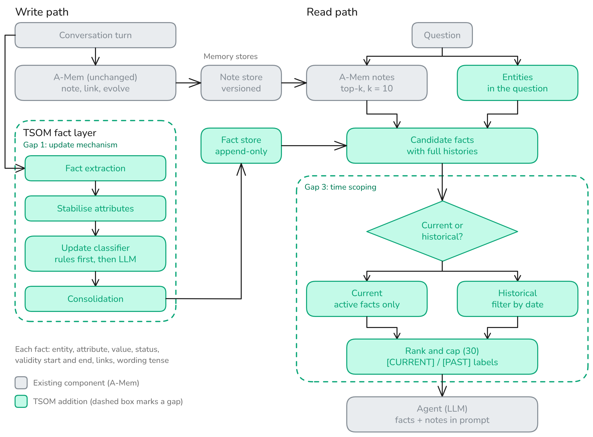

# Time-Scoped Ontological Memory (TSOM)

AI4015 Agentic AI, Fall 2026, group G1-08 (Fatima Sohail, Menahil Ahmad).

## Project overview

TSOM (Time-Scoped Ontological Memory) is a memory layer for LLM agents that runs alongside an unchanged [A-Mem](https://github.com/WujiangXu/AgenticMemory) (Xu et al., NeurIPS 2025), the base paper. A-Mem stores conversation turns as linked notes, but it keeps the old and new values of a changed fact side by side and has no notion of when a fact stopped being true.

TSOM adds an append-only store of `(entity, attribute, value)` facts extracted from every turn. An **update classifier** compares each new fact with what is already stored and decides whether to add it (`ADD`), reaffirm it (`REAFFIRM`), replace it (`REPLACE`), correct it (`CORRECT`) or keep it as history (`ADD_HISTORICAL`), retiring old values by status instead of deleting them. A **time-scoped retriever** then shows the agent the relevant facts labelled `[CURRENT]` or `[PAST]`, depending on whether the question is about now or an earlier period.

"Ontological" only means the memory organises itself at run time, with no formal ontology or fixed schema.

We evaluate TSOM against A-Mem and a RAG baseline on FactConsolidation (MemoryAgentBench), our own change scenarios and LoCoMo, all through one shared agent, tool interface and harness:

- **A-Mem** (`system: amem`): the authors' code, unchanged. Every turn is stored as a linked note, and new notes can rewrite old ones ("evolution").
- **RAG** (`system: rag`): raw turns, top-k retrieval by embedding similarity. No LLM calls on write, no links, no evolution. Same embedder, answer prompts and k as A-Mem.
- **TSOM** (`system: tsom`): A-Mem plus the temporal fact layer. Retrieval returns A-Mem's notes plus the facts behind them, marked `[CURRENT]` or `[PAST]`.

Headline results (Qwen2.5-3B, temperature 0; full numbers in [Gap-resolution table](#gap-resolution-table) and `results/phase2/`): TSOM cuts the stale-answer rate on FactConsolidation SH 6K from 65.8% to 41.9% and holds no contradictory active facts, but it does not improve our change scenarios or past-period questions, and each write costs about 3x more LLM calls than A-Mem's.

## Architecture



**Write path (left).** Every turn goes to A-Mem unchanged (note, link, evolve, into a versioned note store). With `system=tsom` the turn also enters the fact layer: *fact extraction*, *attribute stabilisation* (`tsom/temporal/attributes.py`), the *update classifier* (rules first, then the LLM; **Gap 1**, switch `classifier_mode`) and *consolidation* into the append-only fact store, which retires facts by status and never deletes them. Each fact keeps entity, attribute, value, status, validity start and end, links and the wording's tense.

**Read path (right).** For a question, A-Mem returns its top-k notes (k = 10) and TSOM finds the entities named in the question. Candidate facts with full histories are pulled from the fact store, then the **time-scoped retriever** (**Gap 3**, switch `time_scoped_retrieval`) decides whether the question is about now (active facts only) or an earlier period (filter by date), ranks and caps the facts at 30, and labels them `[CURRENT]` / `[PAST]`. The agent's prompt contains the facts and the notes.

Grey boxes are existing A-Mem components, green boxes are TSOM additions, and dashed boxes mark the two gaps. Every memory write logs its LLM calls, tokens and latency (`tsom/memory.py`); the efficiency results use these logs. RAG replaces both memory paths with raw turns and top-k retrieval.

## Repository layout

```
tsom/            memory module
  contracts.py   Note, Fact, MemoryOp, RunConfig (JSON schemas: python -m tsom.contracts)
  store.py       SQLite tables: notes, operation log, facts (append-only), note versions
  memory.py      wraps A-Mem, logs cost and latency of every write; runs the temporal layer when system=tsom
  temporal/      TSOM: extractor, attribute canonicalizer, update classifier, consolidator, retriever
  rag.py         RAG baseline: raw turns, top-k retrieval, no LLM on write
  tools.py       write_memory, search_memory, get_fact_history
  llm.py         provider setup: Ollama, OpenAI, vLLM, or a fake model for tests
  graph.py       NetworkX view of notes and their links
agent/           the assistant: stores turns, answers questions through the tools
harness/         LoCoMo replay (run_locomo), FactConsolidation replay (run_factcons), change scenarios (run_scenarios), extraction recall (eval_extraction), contradiction rate (contradictions), F1 and BLEU-1 (same definitions as A-Mem), result tables (make_tables)
scripts/         run_baseline.sh, demo.py, demo_temporal.py, inspect_memory.py, generate_scenarios.py, review_scenarios.py, add_past_questions.py
configs/         one JSON file per run
notebooks/       colab_evaluation.ipynb (all Phase 2 experiments), colab_baseline.ipynb (Phase 1 baseline)
third_party/amem A-Mem's code, copied unchanged from a pinned commit (MIT)
data/            locomo10.json (10 conversations, 1,986 questions), scenarios/ (change scenarios)
docs/            devlog.md (development log), tsom-architecture.png (architecture diagram)
results/         phase2/ (final tables, figures, run summaries, trace samples), quick_test*/ (Phase 1)
tests/           offline tests, no model or GPU needed
```

## Installation

### Option 1: Google Colab (free GPU, recommended)

Open `notebooks/colab_baseline.ipynb` (A-Mem baseline) or `notebooks/colab_evaluation.ipynb` (all experiments) in Colab and set the runtime to T4 GPU. They install Ollama, download `qwen2.5:3b`, set the context length, run the tests and then the runs. Results are saved to Google Drive.

### Option 2: your own machine

Needs Python 3.10+ and [Ollama](https://ollama.com). A GPU helps a lot; on CPU the full run is very slow.

Ollama's default context of 4096 tokens cuts off long prompts, so start it with a larger one:

```bash
OLLAMA_CONTEXT_LENGTH=16384 ollama serve
```

```bash
python -m venv .venv && source .venv/bin/activate
pip install -r requirements.txt
ollama pull qwen2.5:3b

python -m pytest -q tests                                    # offline checks, no model needed
python scripts/demo.py                                       # small two-session demo
bash scripts/run_baseline.sh --set max_samples=1 max_questions=20   # quick test
bash scripts/run_baseline.sh                                 # full A-Mem baseline, all 10 conversations
bash scripts/run_baseline.sh --config configs/rag_qwen2.5-3b.json   # full RAG baseline
```

## Running the system

### TSOM and FactConsolidation

```bash
python scripts/demo_temporal.py                          # Ali demo with the real model
python scripts/demo_temporal.py --backend fake           # offline
python scripts/demo_temporal.py --classifier llm_only    # LLM decides every differing value

python -m harness.run_locomo --config configs/tsom_qwen2.5-3b.json --set max_samples=1 max_questions=20
python -m harness.run_factcons --config configs/tsom_qwen2.5-3b.json --variant sh --max-samples 1 --max-questions 20
```

FactConsolidation (MemoryAgentBench, `Conflict_Resolution` split) is loaded from HuggingFace on first use and needs network access once.

#### Update classifier modes

`classifier_mode` in the config (or `--set classifier_mode=llm_only`) controls how a new fact that differs from the stored value is classified:

- `rules_llm` (default): deterministic rules decide first (no existing fact, same value, earlier `valid_from`, past tense before the existing fact, several values already stored, and the optional `seed_multivalued` and `additive_cue` rules). The LLM is asked only for what the rules leave open.
- `llm_only`: the LLM decides every differing value, including `ADD_HISTORICAL`. An empty key (`ADD`) and an identical value (`REAFFIRM`) still need no call. Unparseable output is retried once, then falls back to the rule-based path. `configs/tsom_llmonly_qwen2.5-3b.json` is ready to use.
- `append_only`: the classifier is removed (Gap 1 off). Every differing value is added beside what is stored, with no LLM call, so nothing is ever replaced or retired. `configs/tsom_gap3only_qwen2.5-3b.json` uses it.

In `rules_llm` and `llm_only`, if the LLM's reply still cannot be read, the operation is `UNRESOLVED`: the current fact stays as it is, the new value is logged but not stored as a fact, and the run summary counts it under fact operations.

On Windows without bash, call the harness directly (activate with `.venv\Scripts\activate`):

```
python -m harness.run_locomo --config configs/amem_qwen2.5-3b.json --set max_samples=1 max_questions=20
python -m harness.run_locomo --config configs/rag_qwen2.5-3b.json --set max_samples=1 max_questions=20
```

To use a different model, pick another config (`configs/amem_llama3.2-3b.json`, or `configs/amem_gpt-4o-mini.json` with `OPENAI_API_KEY` set) or override fields: `--set model=llama3.2:3b run_name=my_run`.

#### Fact history tool

With `use_fact_history=true` (`tsom` only), the agent makes one extra LLM call per question to choose between plain search and `get_fact_history`. If it picks history for an entity, that entity's facts, past values included, are added to the context. An unusable reply means plain search. It is off by default and applies to LoCoMo and the change scenarios. FactConsolidation uses its own answer step and always searches.

### Configuration and environment variables

Each run is one JSON `RunConfig` in `configs/` (`tsom/contracts.py`; `python -m tsom.contracts` prints the schema). Override any field with `--set key=value`. The fields that matter most:

| Field | Values | What it does |
|---|---|---|
| `system` | `amem`, `rag`, `tsom` | Which memory system runs |
| `model`, `backend`, `base_url` | e.g. `qwen2.5:3b`, `ollama` | The LLM and where it runs |
| `classifier_mode` | `rules_llm` (default), `llm_only`, `append_only` | Gap 1. `append_only` switches the classifier off |
| `time_scoped_retrieval` | `true` (default), `false` | Gap 3. `false` treats every question as asking about now |
| `use_fact_history` | `false` (default), `true` | Lets the agent choose `get_fact_history` (`tsom` only) |
| `temperature`, `seed`, `send_seed` | e.g. `0`, `1`, `true` | Repeatable runs (see below) |
| `conversations`, `max_samples`, `max_questions` | e.g. `[1,8]` | Which LoCoMo conversations and how many questions |
| `run_name`, `output_dir` | | Where results are written |

Environment variables (copy `.env.example`; never commit `.env`):

| Variable | Needed for |
|---|---|
| `OPENAI_API_KEY` | Only for configs with `backend: openai` or `vllm` |
| `OLLAMA_CONTEXT_LENGTH` | Set to `16384` before `ollama serve`; the evaluation notebook checks it |

### Change scenarios

Short dialogues in which one fact changes, is added to or is restated. Only scenarios marked reviewed are used. `scripts/review_scenarios.py` moves drafts into the reviewed file, one at a time, and the generated drafts come from `scripts/generate_scenarios.py`.

```bash
python -m harness.run_scenarios --config configs/tsom_qwen2.5-3b.json --set run_name=tsom_s1 seed=1
```

Every LLM call uses temperature 0 unless the config sets another value. Each scenario asks for the current value, and scenarios with a change also ask about the earlier period ("Where did Ali live before?" or a dated question), scored as past-period correct. `--limit 100` runs a subset balanced across scenario kinds.

### Extraction recall

`harness/eval_extraction.py` sends each scenario turn to the fact extractor alone and checks how many labelled facts it finds, with the right person and value. It uses no memory or classifier, so a miss is the extractor's own. It has no list of known attribute names, unlike a full run.

```bash
python -m harness.eval_extraction --config configs/tsom_qwen2.5-3b.json --set run_name=extraction_s1
```

### Result tables

`harness/make_tables.py` builds tables from finished runs, with one `--run` per system and one folder per seed:

```bash
python -m harness.make_tables --run amem=results/amem_s1,results/amem_s2,results/amem_s3 --run tsom=results/tsom_s1,results/tsom_s2,results/tsom_s3
```

Each cell shows the mean, the standard deviation across seeds, and a bootstrap 95% confidence interval that resamples questions or scenarios. Missing runs are shown as missing.

### Repeatable runs

Two config fields control this, and both are off by default, so A-Mem's own settings stay in place:

- `temperature`: every LLM call uses this value, including A-Mem's own calls. Leave it unset to reproduce A-Mem's numbers.
- `send_seed`: also sends `seed` to the model.

```bash
python -m harness.run_factcons --config configs/tsom_qwen2.5-3b.json --variant sh --set temperature=0 seed=1 send_seed=true run_name=tsom_sh_t0_s1
```

Each run saves these values in `config.json`.

### What a run produces

Everything goes to `results/<run_name>/`:

- `summary.md` and `summary.json`: F1 and BLEU-1 per LoCoMo category, plus LLM calls and seconds per memory write, and prompt tokens per question.
- `sample_<i>.jsonl`: every question, the prediction, the reference answer and its scores.
- `ops_sample_<i>.jsonl`: a trace of every memory operation (type, LLM calls, tokens, latency).
- `memory_sample_<i>.sqlite`: the memory after the conversation. Look inside with `python scripts/inspect_memory.py results/<run>/memory_sample_0.sqlite --notes 5`. Add `--entity NAME` to list a person's current and past facts, or `--revert FACT_ID` to undo the `REPLACE` or `CORRECT` that created a fact. Reverting changes that file, retracts the new fact and deletes nothing, so keep a copy if you still need to score the run.

If a run stops halfway, run the same command again. Finished conversations are skipped.

## Reproducing the experiments

`notebooks/colab_evaluation.ipynb` runs every experiment on a free Colab or Kaggle T4 GPU and can split the work across several sessions (`WORKERS`, `WORKER`). Set `COMMIT` to the tagged commit so every session runs the same code. The results reported in `results/phase2/` and the paper were produced with code commit `9e1fc0e` (recorded in `results/phase2/setup_worker*.json`), run across four workers on Colab and Kaggle T4 GPUs. The exact command for every run (all three seeds, 6K and 32K) is listed in `results/phase2/experiments.md`; tables and figures are rebuilt with `harness/make_tables.py`, and the outputs land in `results/phase2/` (`tables.md`, `ablation.md`, `efficiency.md`, `failures.md`, `figures/`).

| Experiment | Systems | Data |
|---|---|---|
| E1 baseline | `rag` | FactConsolidation, change scenarios, LoCoMo |
| E2 base paper (A-Mem, reproduced) | `amem` | same |
| E3 full system | `tsom`; variant with `use_fact_history=true` | same |
| E4 gap-wise experiments | `gap1_only` (`time_scoped_retrieval=false`), `gap3_only` (`classifier_mode=append_only`), against `tsom` and `amem`; extraction recall | FactConsolidation 6K, change scenarios |
| E5 ablation | the E4 runs, read as one component removed at a time | FactConsolidation 6K, change scenarios |
| E6 efficiency | LLM calls, tokens, p50/p95 write latency, unreadable replies, failed fact steps | every run's `ops_sample_*.jsonl` |

Single example runs (results go to `results/<run_name>/`):

```bash
python -m harness.run_factcons --config configs/tsom_qwen2.5-3b.json --variant sh --size 6k --set run_name=fc_sh6k_tsom_s1 temperature=0 seed=1 send_seed=true
python -m harness.run_scenarios --config configs/tsom_gap1only_qwen2.5-3b.json --limit 100 --set run_name=scen_gap1_only_s1 temperature=0 seed=1 send_seed=true
python -m harness.run_locomo --config configs/tsom_qwen2.5-3b.json --set "conversations=[1,8]" run_name=locomo_tsom_s1 temperature=0 seed=1 send_seed=true
python -m harness.eval_extraction --config configs/tsom_qwen2.5-3b.json --limit 100 --set run_name=extraction temperature=0
```

All runs use `qwen2.5:3b` at temperature 0 with a 16384-token context.

## Evaluation

FactConsolidation is scored by substring-match accuracy and F1 (`harness/factcons_answer.py`), with the same answer prompt and retrieval call for every memory system.

The stale-answer rate is the share of questions whose fact changed that got a wrong answer matching an older value of that fact. The dataset gives only the newest answer, so older values are read from the numbered facts. On multi-hop questions the rate is an estimate: it counts stale values of the last fact only, so a stale earlier step that leads to a different answer is missed.

The active contradiction rate (`harness/contradictions.py`) counts the keys (entity, attribute) holding two or more different active values, per 100 active facts, at each session checkpoint. FactConsolidation has no sessions, so each chunk is a checkpoint. A-Mem stores no facts, so each `tsom` run is compared with its own extracted facts counted as if nothing had been retired, which is what A-Mem keeps. It is computed from `memory_sample_<i>.sqlite`, so it needs no model calls. Attributes in `multivalued_attributes` are skipped. Other attributes can hold several true values on LoCoMo, so its rate is an upper bound. Facts stored under different attribute names are not compared.

On LoCoMo we follow A-Mem's evaluation (all five question categories, F1 and BLEU-1, the same answer prompts and retrieval k, A-Mem's released code unchanged), but on conversations 1 and 8 rather than all 10, because of compute time. LoCoMo is used as a no-harm check. Our A-Mem numbers are a reproduction with the released code under our settings and are not directly comparable with the published scores, which cover all ten conversations at a different temperature.

## Gap-resolution table

| Gap (component) | Metric | Base paper (A-Mem, reproduced) | Ours (TSOM) | Addressed? |
|---|---|---|---|---|
| Gaps 1+3 (fact layer) | Stale rate, FC SH 6K | 65.8% | 41.9% | Partially |
| Gaps 1+3 (fact layer) | Accuracy, change scenarios | 82.0% | 73.0% | Not |
| Gap 1 (classifier) | Contradictions /100 facts, SH 6K | 24.6† | 0.0 | Fully |
| Gap 3 (retriever) | Past-period correct | 97.9% | 91.7% | Not |
| Write cost (secondary) | LLM calls per write, FC SH 6K | 2.91 | 9.70 | Measured only |

A-Mem is our reproduction under identical settings. † Same extracted facts with nothing retired.

Gap 1 is the update mechanism (deciding whether a new value replaces, corrects or adds to the old one), Gap 3 is time scoping (validity periods and past-period questions), and Gap 2, A-Mem's write cost, is reported as a secondary measurement only. Switches for the ablation: `classifier_mode=append_only` (Gap 1 off) and `time_scoped_retrieval=false` (Gap 3 off). More detail: `results/phase2/gap_table.md`, `ablation.md`, `efficiency.md`, `failures.md`; the story behind each change is in `docs/devlog.md`.

Other final results (same settings): FactConsolidation SH 6K accuracy is 38.0% (RAG), 40.0% (A-Mem), 67.0% (TSOM); SH 32K 38.0%, 42.0%, 79.0%; LoCoMo F1 on conversations 1 and 8 is 25.9, 28.7, 28.8. The change-scenario shortfall is largely upstream: extraction recall is 45.5% (`results/phase2/runs/extraction/`), and 14.1% of TSOM's FactConsolidation answers ignored a correct `[CURRENT]` fact.

## Changes since Phase 1 (final status)

- **Built:** the temporal fact layer (extractor, update classifier with three modes, append-only consolidator, time-scoped retriever) and the `get_fact_history` tool. Added the FactConsolidation harness with stale-answer scoring, the active contradiction rate, change scenarios with past-period questions, extraction recall, result tables with bootstrap confidence intervals, repeatable runs (temperature and seed), the gap-wise ablation configs and the Phase 2 evaluation notebook.
- **No MemGPT-style baseline.** The proposal promised one; it was dropped because of time and compute limits, so RAG is the only baseline besides A-Mem.
- **No Gap 2 conflict gate.** The proposal planned conflict-gated evolution ("Gate (Gap 2)": if no fact is corrective or contradictory and no neighbour passes the similarity threshold tau, store the note with embedding links only and stop). It was prototyped on branch `feat/conflict-gated-evolution`, never merged and not run in Phase 2. Write cost is now a secondary measurement (LLM calls, tokens, p50/p95 latency per write) rather than a research gap, on our supervisor's advice. A-Mem's evolution runs unchanged.
- **LoCoMo on conversations 1 and 8 only.** The proposal said we would use all of LoCoMo10; because of compute time we ran two of its ten conversations (`conversations=[1,8]`) as a no-harm check.
- **Research questions: cost question reworded and moved.** The old RQ2 asked whether conflict-gated evolution reduces LLM calls and write latency compared with A-Mem. With the gate dropped, it became RQ3 and now asks how much extra cost (LLM calls, latency, prompt tokens) the fact layer adds. The validity-period question moved up from RQ3 to RQ2, so the two swapped places. RQ1 is only reworded (latest-value answers instead of contradictory active facts).

## Credits

`third_party/amem/` is from [WujiangXu/AgenticMemory](https://github.com/WujiangXu/AgenticMemory) (MIT licence), commit `0c8039f`. LoCoMo is from Maharana et al., ACL 2024.
